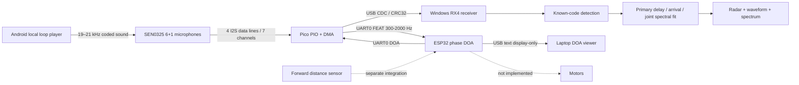

# System composition and integration boundary

Solid arrows are implemented. The ESP32 path is an optional 1000 Hz phase link on branch `Pico-ESP32`; it does not replace RX4 and does not command motors. Dashed connections remain future integration.

## Physical and sample interface

Use the root README GPIO table without substituting breadboard row numbers. Pico drives BCLK/WS; four data lines carry seven used microphone slots. Host channel order is D0L, D0R, D1L, D1R, D2L, D2R, D3R_CENTER. Each raw capture contains 4096 frames at 48000 Hz (85.333 ms of audio), little-endian signed 16-bit samples interleaved by frame: 57,344 payload bytes. The microphones are digital I2S devices; host 16-bit samples do not imply an externally adjustable analog ADC gain.

## USB protocol already implemented

The host requests a block with RECORD in the correct idle/control state. Firmware sends an ASCII `AUDIO ...` line containing seq, frames, fs, channels, bytes, crc32, dropped, rx_stall and process_us; then the binary payload; then `AUDIO_END seq=<same sequence>`. raw_packet.py validates the exact shape, CRC and matching trailer. Do not read this entire stream as text. Existing Session owns the serial port and performs stop/resynchronization; an additional serial monitor must not compete with it.

Header wait includes device capture/work; packet_total_ms is not pure USB transmission time. capture_cycle_ms and DSP time describe different portions of the pipeline. Neither directly measures sound-onset-to-correct-bearing latency.

## Current desktop event interface

`Session.record_beacon()` calls `BeaconEstimator.estimate()` and queues a `direction` event. Important result fields:

| Field | Meaning |
|---|---|
| valid / reason | Current estimate acceptance and diagnostic reason; rejection is not a zero-degree bearing |
| raw_angle_deg | Uncalibrated current-frame model bearing, when accepted |
| angle_deg | View bearing after mirror/heading calibration and temporal smoothing, when accepted |
| confidence | Engineering quality score, not a probability or proof of correct direction |
| received_at | Host monotonic timing; not a shared phone/ESP32 clock |
| code_channels | Channels supporting the known beacon |
| pipeline_timing / request_to_queue_ms | Host instrumentation; use fields according to their documented timing boundaries |

The display convention is 0 degrees at the top and clockwise increasing. Raw geometry starts from the configured ring reference, not an independently verified robot-front/world frame. Use Set Front only after a stable known pose and preserve the offset in the geometry file. Rings are decorative, not measured distance.

## Receiver and phone compatibility

Default coded-20 is a continuous periodic wideband coded waveform, not a pure 20 kHz sine. Import Beacon accepts MP3/WAV only when the decoded reference is compatible: 48 kHz conversion, 4096-sample periodicity, at least 1 kHz occupied bandwidth, useful band within 300–22000 Hz, median adjacent-period correlation at least 0.95. See beacon_importer.py for the complete checks. A standalone pure tone can appear in the spectrum without qualifying for direction estimation.

The Android app is a general local loop player. It does not validate the localization code or calibrate the phone speaker. Its default bundled WAV matches the current reference; optional gain leaves rate, phase/code, channels and duration unchanged. Arbitrary alarm modulation or new chirps require matched receiver work and their own stage.

## Optional Pico–ESP32 UART — implemented as text only

Pico `GP0`/`GP1` at 115200 8N1 talk to ESP32 UART2 (default GPIO16 RX / GPIO17 TX) plus common ground. Pico sends `FEAT,v1,...` with six outer phases/coherences and a center-tone flag. ESP32 replies `DOA,v1,seq,age_ms,valid,reason,angle_deg,quality`. `valid=0` is not a 0° heading. Pico turns the ring off if no new `valid=1` arrives within about 400 ms. USB `RECORD` packets are unchanged and must not share the ESP32 serial monitor.

This estimator is the existing 300–2000 Hz narrowband phase fit, not RX4. Use `FREQ 1000` and an audible tone. The 19–21 kHz coded beacon still belongs on the laptop RX4 path.

## Proposed motor interface — not implemented

Agree stale-result behavior before connecting motors. Distance and obstacle state must come from the separate sensor path. Do not forward an old arrow indefinitely or interpret no detection as permission to turn toward zero degrees.
